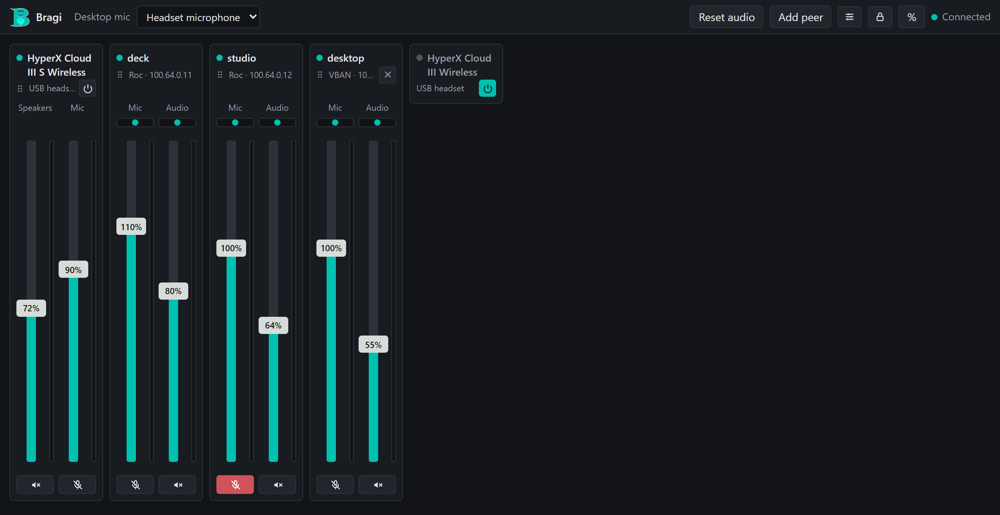
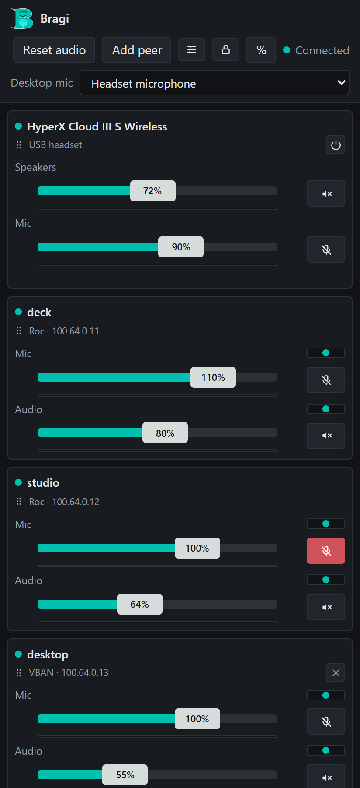
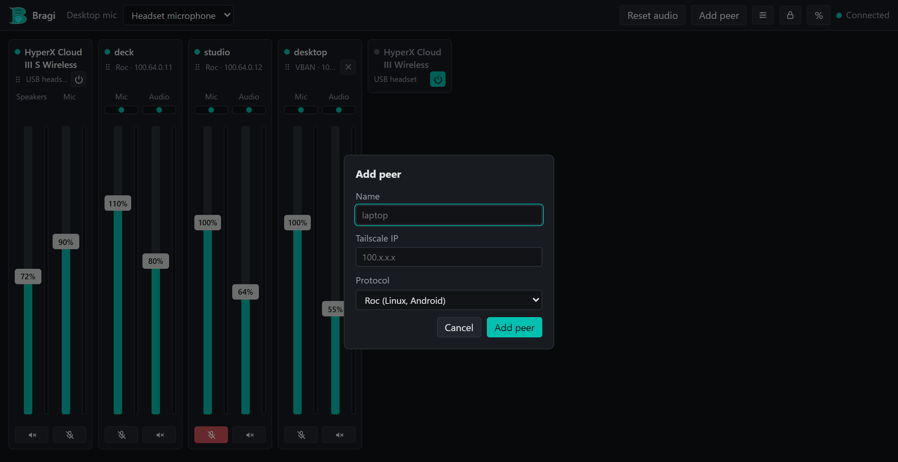

<p align="center">
  
</p>

# Bragi

A dedicated, headless audio hub with a web mixer. Plug a USB headset into
an always-on Linux box (a Raspberry Pi is plenty), run Bragi on it, and the
headset is shared by every machine on your tailnet. Linux desktops, Windows PCs and Android
phones send their audio to it and hear its mic. Bragi is the control panel
on top: per-peer volume and balance in both directions, live level meters,
and adding or removing peers without hand-editing PipeWire config.



Named after the Norse god of poetry and eloquence, fitting for something
that pushes voices around a network.

## What it does

- **Mixer console.** Every headset and peer gets a card with two faders,
  one per direction, with mute, balance, live level meters, and % or dB
  readouts. Every open tab and client stays in sync over a WebSocket.
- **USB headsets, detected automatically.** Whatever is plugged in shows up.
  Switching a headset off releases the USB device entirely, not just mutes
  it. Its physical volume knob works even though the host has no desktop
  session to catch the media keys.
- **Peers over Roc or VBAN.** [Roc](https://roc-streaming.org/) for Linux
  and Android, VBAN for Windows machines running Voicemeeter. Peers added
  from the dashboard go live within about a second, and survive PipeWire
  restarts, reboots and redeploys.
- **Real presence.** A peer running the Bragi desktop client or the
  Android app shows a status dot driven by a live connection, not by
  whether a PipeWire node happens to exist.
- **A desktop tray client and an Android app.** Both are released from this
  repo and update themselves.
- **An HTTP and WebSocket API** with API keys, so other tools can read and
  set volumes. Its guide is served at `/api/v1/help`.
- **Recovery tools.** A "Reset audio" button and a nightly reset (its hour
  set in the dashboard's Settings) restart the PipeWire stack, saving a
  diagnostic snapshot first.

<p align="center">
  
  &nbsp;
  
</p>

## How it fits together

```
                          ┌─ Raspberry Pi ─────────────────────────────┐
 Linux desktop ── Roc ──▶ │  PipeWire + WirePlumber                    │
 Android phone ── Roc ──▶ │  Roc and VBAN modules ◀──▶ USB headset     │
 Windows PC ─── VBAN ───▶ │        ▲                                   │
                          │        │ pw-dump / wpctl / pw-cli          │
 browser, API ─ HTTPS ──▶ │  Bragi (Docker, FastAPI)                   │
                          └────────────────────────────────────────────┘
                                  all over Tailscale
```

Bragi doesn't carry audio. PipeWire does. Bragi shells out to `pw-dump`,
`wpctl` and `pw-cli`, the same tools you'd use by hand, through the
PipeWire socket bind-mounted into its container. Peers added from the
dashboard go into a config file that a `systemd --user` unit on the host
runs as its own PipeWire client, so they keep running whether or not Bragi
is up.

## Quick start

On any Linux box with PipeWire, a USB headset, Docker and Tailscale:

```bash
git clone https://github.com/NickMarcha/bragi.git && cd bragi
host/systemd/install.sh     # host units, and a .env with this host's uid and groups
docker compose up -d --build
tailscale serve --bg --https=443 http://127.0.0.1:8000
```

Open `https://<host>.<tailnet>.ts.net/`, set a password under the lock
icon, and add peers. [`docs/deployment.md`](docs/deployment.md) has the
details: host requirements, peers you already configured by hand, and
running it as a Komodo Stack.

Then connect the peers:

- **Linux desktop.** Run `BragiClient.AppImage` from the latest `client-v*`
  [release](https://github.com/NickMarcha/bragi/releases). Its "Connect to
  Bragi" window registers the machine and sets up the audio link.
  [`client/README.md`](client/README.md).
- **Android.** Install `BragiAndroid.apk` from the latest `android-v*`
  release, enter your Bragi URL, and start.
  [`android/README.md`](android/README.md).
- **Windows.** Add a VBAN peer in the dashboard and point Voicemeeter at
  the Pi on port 6980. The default stream names are `BragiMic` (to the PC)
  and `<Name>Audio` (from it).

## Repository layout

| Path | What |
|---|---|
| `app/` | The server: FastAPI, Jinja templates, htmx and a WebSocket control plane. |
| `host/` | `systemd --user` units and scripts that run on the host, outside the container. |
| `client/` | The Linux tray app (Avalonia, .NET) and its Roc link unit. |
| `android/` | The Android app (Kotlin). |
| `dev/` | A local dev loop: the server on a fake PipeWire, Roc CLI tools, an emulator. |
| `tests/` | Server tests. They run anywhere, no PipeWire needed. |
| `docs/` | Design notes and operations docs. |

## Docs

- [`docs/deployment.md`](docs/deployment.md): installing and running it on
  a host, Tailscale, the host units, the reset button.
- [`docs/development.md`](docs/development.md): the `app/` module map,
  local setup, the test suite and what it can't cover, the `data/` files.
- [`docs/audio-bridge.md`](docs/audio-bridge.md): the PipeWire graph, the
  Roc and VBAN transports, and the parts that took several tries to make
  stable.
- [`docs/dashboard-ui.md`](docs/dashboard-ui.md): the templates, the data
  they render from, and where htmx stops and the WebSocket takes over.
- [`docs/realtime-control-plane.md`](docs/realtime-control-plane.md): how
  live updates work, and the race conditions behind the odd-looking guards.
- [`docs/api-and-access.md`](docs/api-and-access.md): the password, session
  cookies, API keys, and the `/api/v1` API.
- [`docs/backlog.md`](docs/backlog.md): known bugs and deferred work.
- [`dev/README.md`](dev/README.md): Android debugging against a local dev
  server, no Pi or Tailscale needed.

## Development

The tests run on any OS:

```bash
pip install -r requirements-dev.txt
pytest
```

Running the server for real needs a PipeWire session, so in practice you
work on the Pi or another PipeWire-based Linux machine. For UI work without
one, `dev/server.py` runs the real app against the tests' fake PipeWire.
See [`docs/development.md`](docs/development.md).

## Known limitations

These are design constraints. Open bugs are in
[`docs/backlog.md`](docs/backlog.md).

- **No balance on headsets.** WirePlumber treats the hardware mixer as
  authoritative and reverts per-channel volume writes on a real ALSA sink
  within milliseconds. Balance only holds on the software peer nodes.
- **One headset at a time on a Pi 4.** All four USB ports share one
  Full-Speed hub, and two headset streams don't fit reliably. Keep a second
  headset plugged in and switched off. See
  [`docs/audio-bridge.md`](docs/audio-bridge.md#dual-headset-playback-and-why-the-pi-runs-one-headset).
- **VBAN peers share one port and one format.** All use port 6980 at 48 kHz,
  16-bit stereo, and each needs a stream name no other VBAN peer uses.
- **Adding or removing a managed peer briefly drops all of them.** The host
  unit restarts the whole `peers.conf` process, about a second of silence.
- **Peers configured outside Bragi** (`managed: false` in `peers.yaml`) get
  volume control but can't be removed from the UI.
- **Two people dragging the same fader at once** isn't a designed-for case.
  Every client sees the result, but ordering only holds within one client.

## License

[PolyForm Noncommercial 1.0.0](LICENSE.md). You can use, change and share
Bragi for any noncommercial purpose; commercial use needs permission. This
is source-available, not open source in the OSI sense.

Third-party files keep their own licenses: htmx (`app/static/htmx.min.js`,
BSD Zero Clause), the roc-toolkit patch in `client/roc/patches/` (MPL-2.0,
like roc-toolkit), and the agent skills in `.claude/skills/` (adapted from
[mattpocock/skills](https://github.com/mattpocock/skills), MIT).
