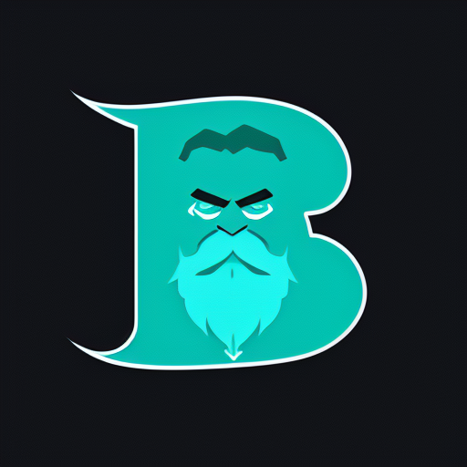
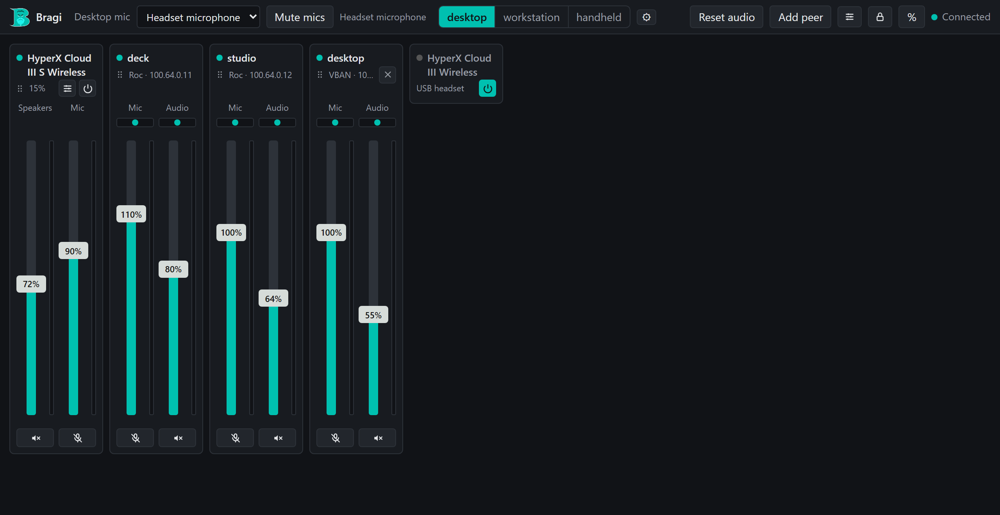
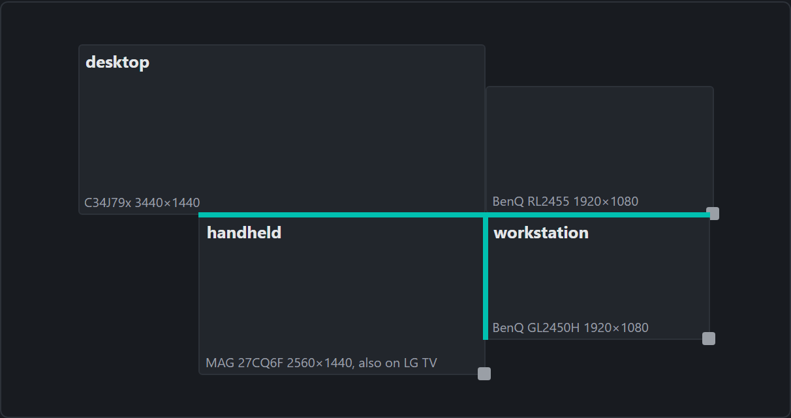
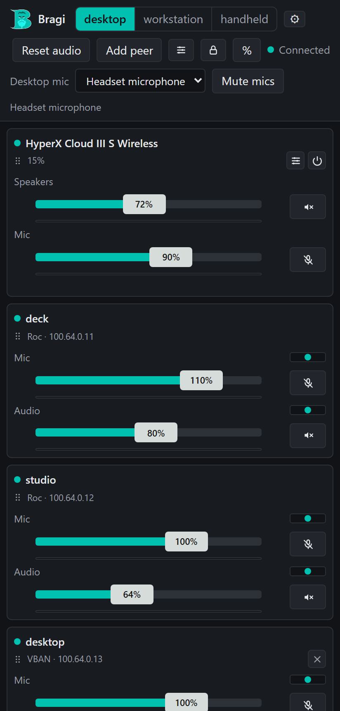
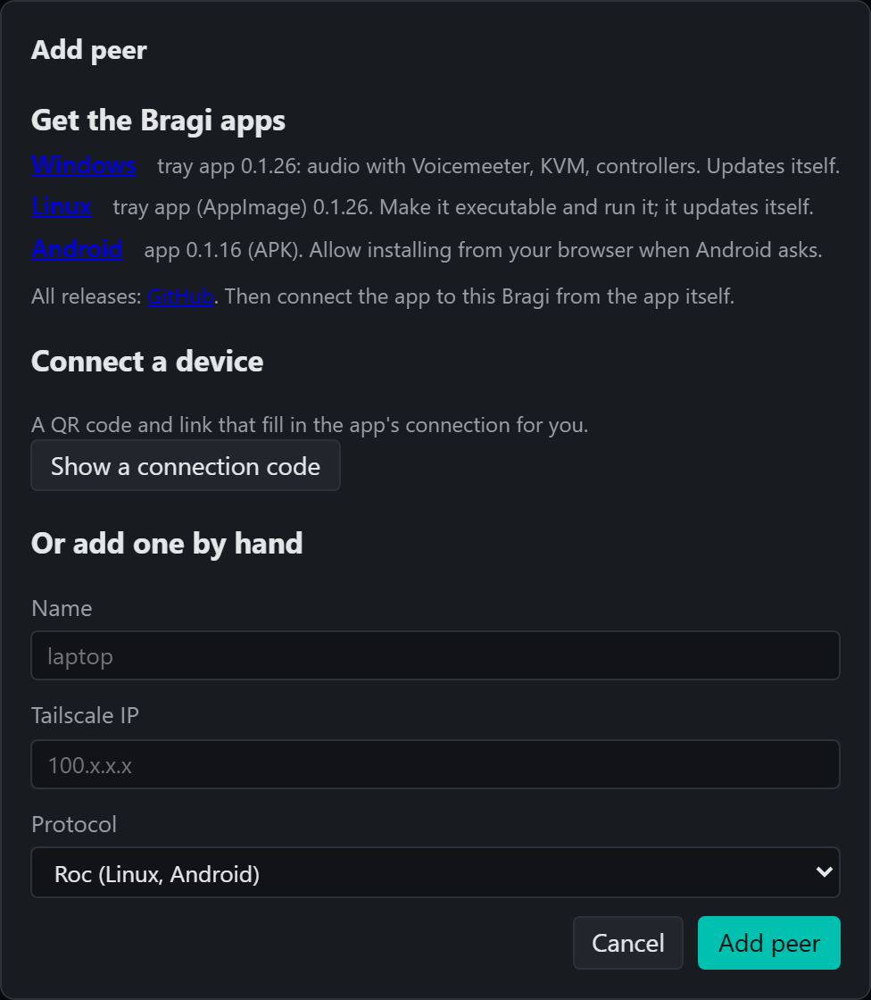

<p align="center">
  
</p>

# Bragi

One always-on box at the desk that owns the shared things: the USB headset,
the keyboard and mouse, the game controllers. Every computer at the desk,
and the phones, uses them through it. You switch computers, not cables.

The box is a Raspberry Pi 4 or a small x86 server, on your tailnet. Bragi
runs on it and is the control panel: a web mixer for the audio, a KVM that
hands the keyboard and mouse to whichever computer you point at, and
dialogs for pairing controllers and wiring buttons to actions. Tray apps
for Linux and Windows and an Android app connect each device to it.



Named after the Norse god of poetry and eloquence, fitting for something
that pushes voices around a network.

## Why

A desk with a few computers and one wireless headset means moving the
headset's dongle to whichever computer you're on, and only that computer
is heard. Software KVMs share the keyboard and mouse, but they place each
computer as one rectangle on a grid, so an ultrawide next to a smaller
monitor leaves corners the cursor falls into.

Bragi turns it around. The peripherals plug into a box that's always on,
and the computers are its peers. The headset plays every computer at
once, its mic goes to all of them, and the keyboard and mouse go to one at
a time.

## What it does

### Audio

- **Mixer console.** Every headset and peer gets a card with two faders,
  one per direction, with mute, balance, live level meters, and % or dB
  readouts. Every open tab and client stays in sync over a WebSocket.
- **USB headsets, detected automatically.** Whatever is plugged in shows
  up, and Settings > Main headset picks which one the peers use. Switching
  a headset off releases the USB device entirely, not just mutes it. Its
  physical volume knob works even though the host has no desktop session.
- **A second headset** for a second person at the desk. It plays
  everything the main one plays (Settings > Second headset).
- **A desk mic** can stand in for the headset mic, and follow the
  headset's mute. "Mute mics" mutes every mic the computers hear.
- **HyperX Cloud III S Wireless extras.** Battery and charging state on the
  card, mic monitoring with its own volume, the auto-off timer, and a
  10-band EQ with built-in and saved presets. The macro button's single,
  double and triple press can each run an action. These need a kernel quirk
  and a udev rule on the host, see
  [`docs/deployment.md`](docs/deployment.md#hyperx-cloud-iii-s-wireless-controls).
- **Peers over Roc or VBAN.** [Roc](https://roc-streaming.org/) for Linux
  and Android, VBAN for Windows. Peers added from the dashboard go live
  within about a second, and survive PipeWire restarts, reboots and
  updates.
- **Recovery.** "Reset audio" and a nightly reset restart the PipeWire
  stack, saving a diagnostic snapshot first.

### Keyboard and mouse (KVM)

The keyboard and mouse plug into the hub, and a
[fork of Deskflow](https://github.com/NickMarcha/deskflow/tree/headless)
runs on it as a headless server. Each computer runs the normal Deskflow
client.

- **The KVM bar** at the top of the dashboard, and the tray menu, give the
  keyboard and mouse to a computer. So do hotkeys and mouse buttons.
- **A layout drawn from the real monitors.** Each tray app reports its
  computer's monitors, and the setup dialog draws each computer as those
  monitors. Drag them until they touch where the cursor should cross. The
  cursor stays on real monitors, so a smaller screen next to an ultrawide
  has no dead corner. See [`docs/kvm-layout.md`](docs/kvm-layout.md).
- **A layout per setup.** Save the layout for the monitors connected now.
  When a dock or a TV cable brings that set back, the KVM switches to it by
  itself.
- **Identify** shows each computer's name on its own screens.

<p align="center">
  
</p>

### Controllers, Bluetooth and buttons

- **Game controllers paired with the hub** play on any computer. "Use
  <controller> here" in the tray moves it. On Linux the computer gets the
  controller itself over `/dev/uhid`, so paddles, Share and rumble work. On
  Windows it's a virtual Xbox pad through ViGEmBus.
- **Bluetooth pairing** for controllers and anything else, from the
  dashboard. The hub has no screen to do it on.
- **Buttons and hotkeys run actions.** Keyboard hotkeys, Logitech mouse
  buttons (HID++) and the headset's macro button can switch computers,
  press keys on the active one, mute mics or send an HTTP request. A
  controller's back paddles can copy another button, and Share can press
  keys.

### Running the hub

- **Tray apps and an Android app**, released from this repo, that update
  themselves. A QR code or link from "Add peer" fills in their connection.
- **Settings > Setup** checks the host (lingering, real-time audio, groups,
  the HyperX quirk, Tailscale) and fixes what it can.
- **Settings > USB** shows which devices share a full-speed USB lane, the
  usual reason a second headset or a mic crackles.
- **Backup and move.** One file holds a hub's settings. Restore it on a new
  box, then "Move" tells every tray app and phone to follow it there.
- **Updates from the dashboard** for Bragi and the Deskflow server.
- **Sign-in** with a password, a passkey, or your Tailscale account, and
  API keys for other tools. The API guide is served at `/api/v1/help`.

<p align="center">
  
  &nbsp;
  
</p>

## How it fits together

```
                     ┌─ hub: Pi 4 or a small x86 box ──────────────┐
 Linux ──── Roc ───▶ │  PipeWire + WirePlumber ◀──▶ USB headsets   │
 Android ── Roc ───▶ │  Roc and VBAN modules                       │
 Windows ── VBAN ──▶ │                                             │
                     │  Deskflow server ◀── USB keyboard and mouse │
 Deskflow clients ◀─ │                                             │
                     │  Bragi ◀── Bluetooth controllers            │
 tray apps ◀──WS───▶ │    drives PipeWire and Deskflow             │
 browser, API ─────▶ │                                             │
                     └─────────────────────────────────────────────┘
                                 all over Tailscale
```

Bragi doesn't carry the audio or the mouse. PipeWire carries the audio, and
Bragi drives it with `pw-dump`, `wpctl` and `pw-cli`, the same tools you'd
use by hand. Peers added from the dashboard go into a config file that a
`systemd --user` unit runs as its own PipeWire client, so they keep running
whether or not Bragi is up. The Deskflow server moves the mouse. Bragi
writes its config, switches it and reads its status. Controllers are the
exception: Bragi reads them on the hub and sends their input to the tray
app on the computer that has them.

## Quick start

On Debian 13 (trixie) or Raspberry Pi OS, arm64 or amd64, with Tailscale:

```bash
curl -fsSL https://nickmarcha.github.io/apt/install.sh | sh   # adds the apt repository, installs bragi
sudo apt install deskflow                                     # the headless KVM server, optional
```

Open the dashboard on `http://127.0.0.1:8000` (an SSH tunnel works), and
work through Settings > Setup. It can set up `tailscale serve` so the
dashboard is at `https://<host>.<tailnet>.ts.net/`. Then set a password
under the lock icon. [`docs/deployment.md`](docs/deployment.md) covers
choosing the box, USB placement, the older Docker setup and moving to a new
hub.

Then connect the devices. "Add peer" in the dashboard has the download
links and a connection code:

- **Linux.** Run `BragiClient.AppImage` from the latest `client-v*`
  [release](https://github.com/NickMarcha/bragi/releases). Its "Connect to
  Bragi" window registers the machine and sets up the audio link and the
  Deskflow client's server address. [`client/README.md`](client/README.md).
- **Windows.** Install `BragiClient-win-Setup.exe` from the same release.
  The tray app sends and receives the VBAN audio itself, through any
  Windows audio device.
- **Android.** Install `BragiAndroid.apk` from the latest `android-v*`
  release and scan the connection code. [`android/README.md`](android/README.md).

## Repository layout

| Path | What |
|---|---|
| `app/` | The server: FastAPI, Jinja templates, htmx and a WebSocket control plane. |
| `host/` | `systemd --user` units and scripts that run on the host. |
| `packaging/` | The Debian package. |
| `client/` | The Linux and Windows tray app (Avalonia, .NET) and its Roc link unit. |
| `android/` | The Android app (Kotlin). |
| `dev/` | A local dev loop: the server on a fake PipeWire, Roc CLI tools, an emulator. |
| `tests/` | Server tests. They run anywhere, no PipeWire needed. |
| `docs/` | Design notes and operations docs. |

## Docs

- [`docs/deployment.md`](docs/deployment.md): choosing the box, installing
  from apt, USB placement, Tailscale, the host units, the reset button, the
  HyperX controls' kernel quirk and udev rule, moving to a new hub.
- [`docs/kvm-layout.md`](docs/kvm-layout.md): why the KVM draws monitors
  instead of a grid, and how the layout reaches the Deskflow fork.
- [`docs/development.md`](docs/development.md): the `app/` module map,
  local setup, the test suite and what it can't cover, the `data/` files.
- [`docs/audio-bridge.md`](docs/audio-bridge.md): the PipeWire graph, the
  Roc and VBAN transports, and the parts that took several tries to make
  stable.
- [`docs/eq-presets.md`](docs/eq-presets.md): where the HyperX EQ presets
  come from, the headset measurement behind them, and safe gain limits.
- [`docs/dashboard-ui.md`](docs/dashboard-ui.md): the templates, the data
  they render from, and where htmx stops and the WebSocket takes over.
- [`docs/realtime-control-plane.md`](docs/realtime-control-plane.md): how
  live updates work, and the race conditions behind the odd-looking guards.
- [`docs/api-and-access.md`](docs/api-and-access.md): the password, session
  cookies, API keys, and the `/api/v1` API.
- [`docs/backlog.md`](docs/backlog.md): known bugs and deferred work.
- [`dev/README.md`](dev/README.md): Android debugging against a local dev
  server, no hub or Tailscale needed.

## Development

The tests run on any OS:

```bash
pip install -r requirements-dev.txt
pytest
```

Running the server for real needs a PipeWire session, so in practice you
work on the hub or another PipeWire-based Linux machine. For UI work without
one, `dev/server.py` runs the real app against the tests' fake PipeWire.
The screenshots above come from it. See
[`docs/development.md`](docs/development.md).

## Known limitations

These are design constraints. Open bugs are in
[`docs/backlog.md`](docs/backlog.md).

- **No balance on headsets.** WirePlumber treats the hardware mixer as
  authoritative and reverts per-channel volume writes on a real ALSA sink
  within milliseconds. Balance only holds on the software peer nodes.
- **One headset at a time on a Pi 4.** All four USB ports share one
  full-speed lane, and two headset streams don't fit reliably. A box whose
  USB ports sit on separate controllers (an HP MicroServer N54L runs two
  headsets) avoids it. Settings > USB shows which devices share a lane. See
  [`docs/audio-bridge.md`](docs/audio-bridge.md#dual-headset-playback-and-why-the-pi-runs-one-headset)
  and "USB placement" in [`docs/deployment.md`](docs/deployment.md#usb-placement).
- **Monitor shapes need the fork.** Upstream Deskflow treats each computer
  as one rectangle. Bragi only writes the monitors when the server reports
  it understands them, otherwise the layout falls back to whole-computer
  edges.
- **VBAN peers share one port and one format.** All use port 6980 at 48 kHz,
  16-bit stereo, and each needs a stream name no other VBAN peer uses.
- **Adding or removing a managed peer briefly drops all of them.** The host
  unit restarts the whole `peers.conf` process, about a second of silence.
- **The HyperX EQ can't be read back.** The headset has no command for it,
  so the dashboard shows the last EQ Bragi set. One set from NGENUITY on
  another computer won't show.
- **Two people dragging the same fader at once** isn't a designed-for case.
  Every client sees the result, but ordering only holds within one client.

## License

[PolyForm Noncommercial 1.0.0](LICENSE.md). You can use, change and share
Bragi for any noncommercial purpose; commercial use needs permission. This
is source-available, not open source in the OSI sense.

Third-party files keep their own licenses: htmx (`app/static/htmx.min.js`,
BSD Zero Clause), the roc-toolkit patch in `client/roc/patches/` (MPL-2.0,
like roc-toolkit), and the agent skills in `.claude/skills/` (adapted from
[mattpocock/skills](https://github.com/mattpocock/skills), MIT).
